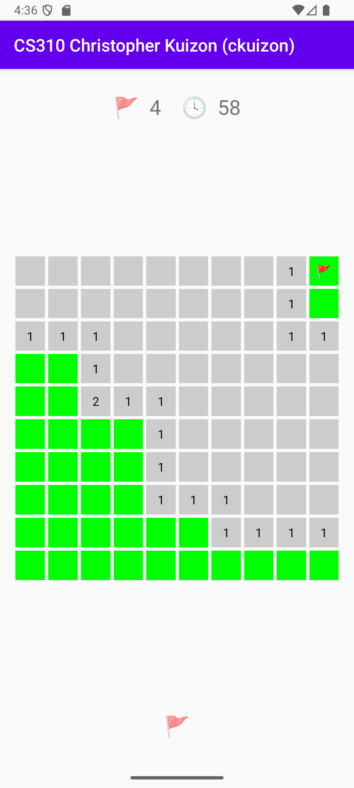
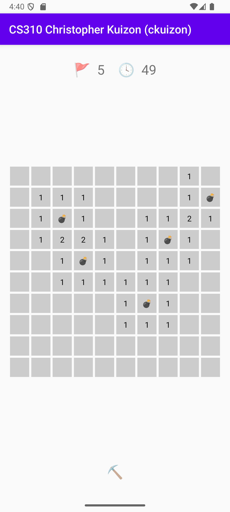
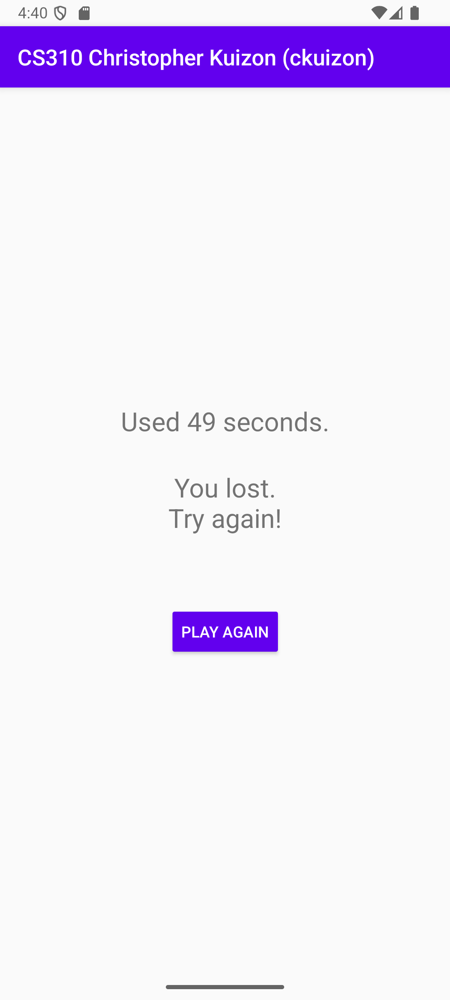

# Minesweeper

A 10×10 Minesweeper game for Android, written in Java. Built for USC CSCI 310 (Fall 2025).

<p>
  
  
  
</p>

## Features

- 10×10 board with 5 randomly placed mines
- Tap to reveal a cell; cells with no adjacent mines open their neighbors automatically
- Toggle between pick (⛏️) and flag (🚩) mode with the button under the board
- Flag counter and timer at the top; the timer pauses while the app is in the background
- On a win or loss every mine is shown, and the next tap opens a results screen with your time
- Game state survives screen rotation, and the layout adapts to portrait and landscape

## Architecture

| Class | Responsibility |
| --- | --- |
| [`Board`](app/src/main/java/com/example/minesweeper/Board.java) | Game rules with no Android dependencies: mine placement, adjacency counts, reveal with flood fill, flagging, and the win check |
| [`GameViewModel`](app/src/main/java/com/example/minesweeper/GameViewModel.java) | Holds the `Board` plus session state (clock, mode, won or lost) so it survives configuration changes such as rotation |
| [`MainActivity`](app/src/main/java/com/example/minesweeper/MainActivity.java) | Builds the grid of cells, forwards taps to the `Board`, and redraws every cell from its state; runs the timer between `onResume` and `onPause` |
| [`ResultsActivity`](app/src/main/java/com/example/minesweeper/ResultsActivity.java) | Shows the result and time; "Play again" returns to a fresh game without growing the back stack |

A few design notes:

- **State lives outside the Activity.** Android destroys and recreates an Activity on rotation. Keeping the game in a `ViewModel` means the board, flags, and clock are kept, and the Activity only draws them.
- **The view renders from the model.** After every tap, `drawBoard()` repaints all cells from `Board`. The same method handles normal updates, rotation, and the game-over view.
- **Flood fill is iterative.** Revealing a cell with no adjacent mines uses a BFS queue rather than recursion, so larger boards can't overflow the stack.
- **The timer can't leak the Activity.** Its `Runnable` is removed in `onPause`, so a destroyed Activity isn't kept alive by a pending callback.

## Building and running

Requirements: Android Studio (or JDK 17 and the Android SDK, API level 36).

Open the project in Android Studio and run the `app` configuration on an emulator or device. From the command line, with an emulator running:

```bash
./gradlew installDebug
```

## Tests

`Board` is plain Java, so its unit tests run on the JVM without an emulator:

```bash
./gradlew testDebugUnitTest
```

[`BoardTest`](app/src/test/java/com/example/minesweeper/BoardTest.java) covers adjacency counts (including corners and edges), revealing mines and numbered cells, flood fill and its interaction with flags, flag counting, and the win check.

## Possible next steps

- Difficulty levels (board size and mine count are already constructor parameters of `Board`)
- First tap is always safe, by placing mines after the first reveal
- Survive process death by saving state through `SavedStateHandle`
